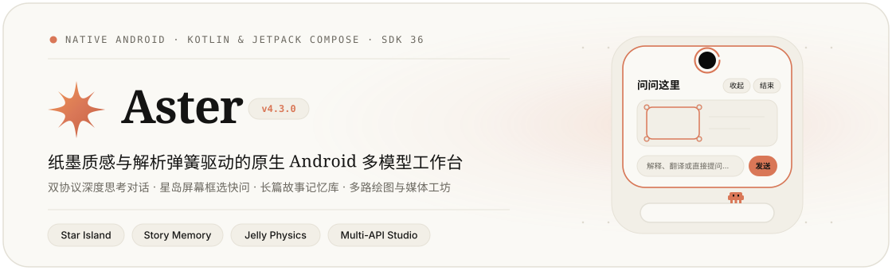

<p align="center">
  
</p>

<p align="center">
  <a href="https://github.com/adongshaln/Aster/releases/latest"></a>
  
  
  <a href="CHANGELOG.md"></a>
</p>

---

**Aster** 是一款以**纸墨排版美学**与**连续解析弹簧物理**为核心的原生 Android 多模型工作台。

它拒绝套壳网页应用，每一帧形变、每一枚胶囊与每一段排版都使用纯 Kotlin 与 Jetpack Compose 原生构建；同时将跨应用屏幕框选快问、双协议深度思考对话、结构化长篇叙事记忆、多通道图像创作与无水印流媒体工坊收纳进同一处克制而温润的空间。

<br/>

## 一、交互哲学：一笔墨线，万物有形

Aster 的所有界面遵循同一套物理与材质法则，不允许任何生硬的闪现或突兀的弹窗：

<table>
  <tr>
    <td width="33%" valign="top">
      <h4>01 · 连续墨线轮廓</h4>
      <p>常驻前摄挖孔外的手绘陶土墨线圈并非装饰图标，而是整套悬浮系统的<b>唯一拓扑种子</b>。无论是抽出剪贴板纸签、铺满物理屏幕边缘的截屏框选层，还是收拢吐出紧凑提问卡，皆由同一条 288 点采样轮廓在原位流变而成。</p>
    </td>
    <td width="33%" valign="top">
      <h4>02 · 闭式解阻尼弹簧</h4>
      <p>所有开合、果冻挤压与回弹均由绝对时间的解析阻尼微分方程直接采样，不逐帧累加误差，在 60Hz、90Hz 与 120Hz 屏幕上呈现完全一致的轨迹；任意时刻中途反向都能完整继承当前位置与速度动量。</p>
    </td>
    <td width="34%" valign="top">
      <h4>03 · 文学衬线与纸面</h4>
      <p>暖纸画布（<code>#F5F3EF</code>）、轻盈纸面（<code>#FFFDFA</code>）与墨色主操作，搭配衬线标题和分层正文排版；深色模式单独处理表面与文字层次。输入胶囊上的原生像素伙伴 <b>Clawd</b> 跟随你的敲击、停顿与模型吐字律动。</p>
    </td>
  </tr>
</table>

<br/>

## 二、五大核心场域

### 1. 星岛（Star Island）—— 跨应用前摄交互中枢
无需切出当前正在阅读的文章、视频或聊天窗口，围绕前摄镜头的墨线圈即可随手调用模型能力：
- **长按屏幕框选快问**：墨线沉入镜头并冻结当前帧，随后严丝合缝铺满整块物理屏幕与硬件圆角；手指按下即绽开锚点环，拖动全程实时反馈圆角高亮开窗、纸芯陶土四角扣眼与像素尺寸胶囊。确认选区后收回镜头，再吐出紧凑提问卡；提问发送后卡片自动向下弹性生长出回答区，支持连续多轮追问。
- **点按剪贴板随手处理**：仅在主动点按瞬间读取一次剪贴板——文字一键**中英互译、原意润色、通俗解释**（强制极速最小推理直出，搭配纸墨 Markdown 排版）；普通网页抓取正文生成离线摘要；抖音、B 站、X 媒体链接支持**在星岛紧凑卡片内零打断后台解析、无水印合轨/合成并自动存入系统相册**。
- **全场景智能隐退与恢复**：自动识别系统顶部状态栏真实可见性、横竖屏旋转与锁屏状态——看视频沉浸全屏或横屏时自动果冻收拢隐退，切回竖屏或指纹/人脸解锁后丝滑浮现并完整保留既有问答上下文。

### 2. 深度对话舱 —— 双协议推理与实时诊断
- **多协议自由路由**：原生支持 OpenAI **Responses API**、**Chat Completions** 与 **Anthropic Messages**（含原生联网搜索与委托搜索模型路由，完整保留信源引用）。
- **全彩厂商艺术字标与错峰计费**：内置 26 家主流大模型厂商全彩徽标与定制艺术字组合（Combine Lockup）、48 条模型家族与档位中文简介、DeepSeek 错峰优惠时段实时倒计时，以及支持人民币（`¥`）/美元（`$`）切换与自定义单价表的精准计费系统。
- **无干扰思考手风琴**：推理模型的思考链实时独立流式呈现，正文开始输出时自动平滑折叠，绝不混入历史上下文污染后续轮次；断流中断后支持原位安全续写。
- **输入与引用**：设置中可选择回车发送或换行；文件以卡片添加并在本地保留原件，提取文字不占据输入栏；支持整条消息和选中文字的引用卡片。详见 [输入、附件与引用](docs/COMPOSER_CONTEXT.md)。
- **弹性输入胶囊**：聚焦弹性展开，悬浮滑轨支持连续拖动调节模型思考强度（松手吸附受支持档位，最高档绽放有限时长星芒流光），并支持最多 1M 自定义上下文预算与独立快速模型的淡色内联输入预测。

### 3. 剧情 RP —— 角色卡与独立会话
- **角色与上下文配置**：导入角色卡，选择开场白、用户人设、世界书和酒馆预设，按剧情会话保存配置。
- **回复与会话管理**：支持重生成、回复切换、续写、代写、消息编辑和会话分支；会话按文件独立保存，生成中保存断点。
- **卡片呈现与权限**：支持剧情 HTML 状态栏、正则、模板及本地 helper 资源；卡片脚本需要明确授权，无脚本授权的状态栏仍能正常展开与测量高度。

旧故事工作区已废弃，不再作为当前功能入口。剧情 RP 与其数据结构、交互流程分别维护。

### 4. 制图与视觉流水线 —— 并发画布与原位嵌字翻译
- **三协议绘图引擎**：统一接入 OpenAI Images、Gemini 视觉生成模型与 NovelAI Diffusion，支持多参考图编辑与多任务独立快照并发生成。
- **双模型漫画翻译流水线**：先由视觉理解模型通读分镜剧情、人物关系与对白语境，再交由图像生成模型逐页原位擦除并嵌字替换，两阶段可自由跨服务商组合。

### 5. 交付物与流媒体工坊 —— 真实文档与全场景无水印媒体
- **真实离线文档生成**：通过内置工具直接产出标准 `.pdf`、`.docx`、`.xlsx`、`.pptx` 与 `.svg` 文件；代码块中的 `HTML` 与 `Mermaid` 流程图在断网加固的离线沙盒中即时渲染预览。
- **全场景无水印流媒体与实况图文合成**：
  - **抖音无水印视频 & 动态/静态图文配乐合成**：自动识别普通视频、实况动图（Live Photo）与多图配乐笔记，通过硬件 `MediaCodec` + `MediaMuxer` 将无水印原图或实况动图流与背景音乐（M4A 直拷 / MP3 转 AAC）无损合成为 1080P 标准 `.mp4` 视频；
  - **B 站 TV 端 1080P / 4K 无水印合轨**：接入 B 站云视听小电视签名接口提取未烧录水印的纯净 DASH 分轨流，支持本机一键拉起哔哩哔哩客户端授权解锁 `1080P / 1080P60 / 4K · 无水印`，原生 `MediaMuxer` 极速无损合轨与 Media3 双轨同步预览；
  - **视频转 GIF 工坊**：内置调色板优化的三档预设 GIF 编码器。
- **工作区级 Skill 扩展**：支持从 GitHub 仓库或本地 ZIP 安装工具技能包，按会话/工作区独立开关，内置工具调用循环熔断保护。

<br/>

## 三、架构与隐私边界

```text
┌───────────────────────────────────────────────────────────────────────────┐
│                         Aster Native UI (Compose)                         │
│   Chat Capsule & Clawd  ·  RP Workspace  ·  Studio  ·  Usage Console      │
├───────────────────────────────────┬───────────────────────────────────────┤
│     Star Island Overlay Engine    │         Multi-API Router Layer        │
│  · 288-Sample Continuous Contour  │  · OpenAI Responses / Chat SSE        │
│  · Analytic Damped Jelly Springs  │  · Anthropic Messages Web Search      │
│  · Bezel-Flush Crop & Question    │  · Gemini / Images / NovelAI Studio   │
│  · One-Shot A11y Screenshot Host  │  · One-Shot Replay Guard & Metering   │
├───────────────────────────────────┴───────────────────────────────────────┤
│                     Local-First Persistence & Sandbox                     │
│  · Per-Session RP Files          · Hardened Offline Mermaid/HTML WebView │
│  · Memory-Only Screen Crops       · Native PDFBox / Office / GIF Encoder  │
└───────────────────────────────────────────────────────────────────────────┘
```

- **零后台窥探**：星岛绝不后台轮询剪贴板，绝不读取或遍历其他应用的界面节点树（`canRetrieveWindowContent="false"` 硬件级强制关闭）。
- **阅后即焚的屏幕选区**：长按截屏的原图与裁剪框仅暂存于内存，不写相册、不落磁盘；仅在你点击「发送」时，才将**裁剪后的选区局部图像**（最长边 ≤ 1600px）发往你自己配置的对话接口。
- **计费安全保护**：所有模型生成请求采用 One-Shot 传输标记，收到首字节或服务端已受理后断连绝不隐式重放 POST，杜绝弱网环境下的重复扣费。

<br/>

## 四、构建、联调与发布

### 环境要求
- **JDK**：Java 17
- **Android SDK**：Compile / Target SDK `36`，Min SDK `26`（Android 8.0+；星岛长按截屏提问需 Android 11+）

### 常用命令

```bash
# 运行全部 Robolectric 与 JVM 单元测试（640+ 项几何、物理、协议与数据库迁移回归）
./gradlew testDebugUnitTest

# 构建 Debug 安装包
./gradlew assembleDebug

# 构建 Release 安装包（配置 keystore.properties 后自动输出正式签名包）
./gradlew assembleRelease
```

### 本地双服务 Mock 联调
仓库内置轻量级双协议模拟网关，无需消耗真实 Token 即可在模拟器或真机上联调对话与绘图分流：

```bash
python3 tools/mock_api.py --port 8000 --label chat-api
python3 tools/mock_api.py --port 8001 --label image-api
```
> 模拟器内可将对话地址指向 `http://10.0.2.2:8000`，绘图地址指向 `http://10.0.2.2:8001`。

### 持续集成与固定签名
- 本地签名可将 `keystore.properties.example` 复制为 `keystore.properties`（已被 Git 忽略，切勿提交私钥）；升级覆盖安装需保持同一套签名证书。
- GitHub Actions 在推送与 `v*` 标签发布时执行单元测试、Release 构建与 `apksigner` 签名校验，并在版本标签构建成功后发布附带正式签名 APK 的 GitHub Release。

<br/>

## 五、深入设计文档

想了解某个子系统的数学推导、状态机契约或迁移细节，可查阅 `docs/` 目录下的专题档案：

| 专题领域 | 文档入口 |
| --- | --- |
| 星岛轮廓拓扑、屏幕提问与无障碍边界 | [docs/STAR_ISLAND.md](docs/STAR_ISLAND.md) · [docs/ISLAND_CLAUDE_INK.md](docs/ISLAND_CLAUDE_INK.md) |
| 输入胶囊、内联预测、思考浮层与 Clawd 物理 | [docs/COMPOSER_CAPSULE.md](docs/COMPOSER_CAPSULE.md) · [docs/CLAWD_NATIVE_PORT.md](docs/CLAWD_NATIVE_PORT.md) |
| 原生视觉升级与实际覆盖记录 | [docs/ASTER_DESIGN_UPGRADE_PLAN.md](docs/ASTER_DESIGN_UPGRADE_PLAN.md) · [docs/ASTER_VISUAL_UPGRADE_DELIVERY.md](docs/ASTER_VISUAL_UPGRADE_DELIVERY.md) |
| 旧故事模式历史方案（已废弃） | [docs/STORY_MODE_IMPLEMENTATION_PLAN.md](docs/STORY_MODE_IMPLEMENTATION_PLAN.md) · [docs/STORY_MODE_ACCEPTANCE.md](docs/STORY_MODE_ACCEPTANCE.md) |
| Anthropic 联网搜索、委托搜索与上下文预算 | [docs/ANTHROPIC_MESSAGES.md](docs/ANTHROPIC_MESSAGES.md) · [docs/DELEGATED_SEARCH.md](docs/DELEGATED_SEARCH.md) · [docs/MODEL_CONTEXT.md](docs/MODEL_CONTEXT.md) |
| 离线文档生成、沙盒预览与 Skill 包规范 | [docs/DOCUMENT_GENERATION.md](docs/DOCUMENT_GENERATION.md) · [docs/HTML_PREVIEW.md](docs/HTML_PREVIEW.md) · [docs/SKILLS.md](docs/SKILLS.md) |
| 完整稳定版演进历史 | [CHANGELOG.md](CHANGELOG.md) |
