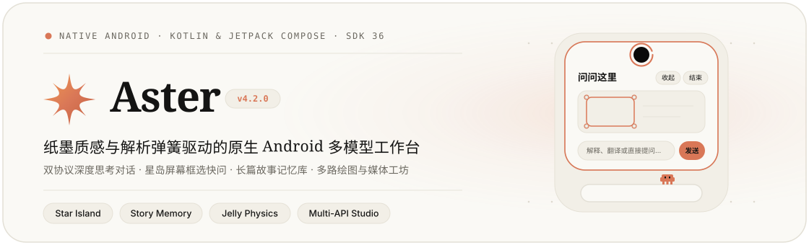

<p align="center">
  
</p>

<p align="center">
  <a href="https://github.com/adongshaln/Aster/releases/latest"></a>
  
  
  <a href="CHANGELOG.md"></a>
</p>

---

**Aster** 是一款以**纸墨排版美学**与**连续解析弹簧物理**为核心的原生 Android 多模型工作台。

它拒绝套壳网页应用，每一帧形变、每一枚胶囊与每一段排版都使用纯 Kotlin 与 Jetpack Compose 原生构建；同时将跨应用屏幕框选快问、双协议深度思考对话、结构化长篇叙事记忆、多通道图像创作与无水印流媒体工坊收纳进同一处克制而温润的空间。

<br/>

## 一、交互哲学：一笔墨线，万物有形

Aster 的所有界面遵循同一套物理与材质法则，不允许任何生硬的闪现或突兀的弹窗：

<table>
  <tr>
    <td width="33%" valign="top">
      <h4>01 · 连续墨线轮廓</h4>
      <p>常驻前摄挖孔外的手绘陶土墨线圈并非装饰图标，而是整套悬浮系统的<b>唯一拓扑种子</b>。无论是抽出剪贴板纸签、铺满物理屏幕边缘的截屏框选层，还是收拢吐出紧凑提问卡，皆由同一条 288 点采样轮廓在原位流变而成。</p>
    </td>
    <td width="33%" valign="top">
      <h4>02 · 闭式解阻尼弹簧</h4>
      <p>所有开合、果冻挤压与回弹均由绝对时间的解析阻尼微分方程直接采样，不逐帧累加误差，在 60Hz、90Hz 与 120Hz 屏幕上呈现完全一致的轨迹；任意时刻中途反向都能完整继承当前位置与速度动量。</p>
    </td>
    <td width="34%" valign="top">
      <h4>03 · 文学衬线与纸面</h4>
      <p>象牙暖纸（<code>#FAF9F5</code>）与温润炭黑（<code>#262624</code>）双色调色板，搭配可变字重文学衬线标题与高易读度正文排版。输入胶囊上的原生像素伙伴 <b>Clawd</b> 实时跟随你的敲击、停顿与模型吐字律动。</p>
    </td>
  </tr>
</table>

<br/>

## 二、五大核心场域

### 1. 星岛（Star Island）—— 跨应用前摄交互中枢
无需切出当前正在阅读的文章、视频或聊天窗口，围绕前摄镜头的墨线圈即可随手调用模型能力：
- **长按屏幕框选快问**：墨线沉入镜头并冻结当前帧，随后严丝合缝铺满整块物理屏幕与硬件圆角；手指按下即绽开锚点环，拖动全程实时反馈圆角高亮开窗、纸芯陶土四角扣眼与像素尺寸胶囊。确认选区后收回镜头，再吐出紧凑提问卡；提问发送后卡片自动向下弹性生长出回答区，支持连续多轮追问。
- **点按剪贴板随手处理**：仅在主动点按瞬间读取一次剪贴板——文字一键**中英互译、原意润色、通俗解释**；普通网页抓取正文生成离线摘要；媒体短链直达解析与下载。
- **全场景智能隐退与恢复**：自动识别系统顶部状态栏真实可见性、横竖屏旋转与锁屏状态——看视频沉浸全屏或横屏时自动果冻收拢隐退，切回竖屏或指纹/人脸解锁后丝滑浮现并完整保留既有问答上下文。

### 2. 深度对话舱 —— 双协议推理与实时诊断
- **多协议自由路由**：原生支持 OpenAI **Responses API**、**Chat Completions** 与 **Anthropic Messages**（含原生联网搜索与委托搜索模型路由，完整保留信源引用）。
- **无干扰思考手风琴**：推理模型的思考链实时独立流式呈现，正文开始输出时自动平滑折叠，绝不混入历史上下文污染后续轮次；断流中断后支持原位安全续写。
- **弹性输入胶囊**：聚焦弹性展开，悬浮滑轨支持连续拖动调节模型思考强度（松手吸附受支持档位，最高档绽放有限时长星芒流光），并支持最多 1M 自定义上下文预算与独立快速模型的淡色内联输入预测。
- **模型用量仪表盘**：按模型与服务商精准统计请求次数、输入/输出/推理 Token 与估算开销，支持钻取查看单次请求级诊断明细。

### 3. 故事工作区 —— 结构化记忆与设定隔离
专为超长篇互动叙事与共同创作打造的独立 SQLite（Schema v12）工作区：
- **正文与讨论硬边界**：内置 `[ASTER_STORY_DISCUSSION_MODE]` 架构级隔离——在「讨论区」商讨大纲、推敲人设或选段试改绝不会污染正式小说成稿，讨论候选需经确认才可升格为设定。
- **自动档案与冲突仲裁**：后台按完整有效版本自动沉淀人物档案、客观剧情事实、角色主观认知与关系网，自动识别结构化状态矛盾并交由创作者裁决，支持多路线快照分支与 SillyTavern 酒馆预设导入。

### 4. 制图与视觉流水线 —— 并发画布与原位嵌字翻译
- **三协议绘图引擎**：统一接入 OpenAI Images、Gemini 视觉生成模型与 NovelAI Diffusion，支持多参考图编辑与多任务独立快照并发生成。
- **双模型漫画翻译流水线**：先由视觉理解模型通读分镜剧情、人物关系与对白语境，再交由图像生成模型逐页原位擦除并嵌字替换，两阶段可自由跨服务商组合。

### 5. 交付物与流媒体工坊 —— 真实文档与无水印媒体
- **真实离线文档生成**：通过内置工具直接产出标准 `.pdf`、`.docx`、`.xlsx`、`.pptx` 与 `.svg` 文件；代码块中的 `HTML` 与 `Mermaid` 流程图在断网加固的离线沙盒中即时渲染预览。
- **流媒体解析与动图工坊**：支持抖音无水印高清源与 B 站分享链接解析、在线预览、Range 多段断点续传（含 MP4 文件头校验），以及内置调色板优化的视频转三档预设 GIF 编码器。
- **工作区级 Skill 扩展**：支持从 GitHub 仓库或本地 ZIP 安装工具技能包，按会话/工作区独立开关，内置工具调用循环熔断保护。

<br/>

## 三、架构与隐私边界

```text
┌───────────────────────────────────────────────────────────────────────────┐
│                         Aster Native UI (Compose)                         │
│   Chat Capsule & Clawd  ·  Story Workspace  ·  Studio  ·  Usage Console   │
├───────────────────────────────────┬───────────────────────────────────────┤
│     Star Island Overlay Engine    │         Multi-API Router Layer        │
│  · 288-Sample Continuous Contour  │  · OpenAI Responses / Chat SSE        │
│  · Analytic Damped Jelly Springs  │  · Anthropic Messages Web Search      │
│  · Bezel-Flush Crop & Question    │  · Gemini / Images / NovelAI Studio   │
│  · One-Shot A11y Screenshot Host  │  · One-Shot Replay Guard & Metering   │
├───────────────────────────────────┴───────────────────────────────────────┤
│                     Local-First Persistence & Sandbox                     │
│  · Isolated Story SQLite (v12)    · Hardened Offline Mermaid/HTML WebView │
│  · Memory-Only Screen Crops       · Native PDFBox / Office / GIF Encoder  │
└───────────────────────────────────────────────────────────────────────────┘
```

- **零后台窥探**：星岛绝不后台轮询剪贴板，绝不读取或遍历其他应用的界面节点树（`canRetrieveWindowContent="false"` 硬件级强制关闭）。
- **阅后即焚的屏幕选区**：长按截屏的原图与裁剪框仅暂存于内存，不写相册、不落磁盘；仅在你点击「发送」时，才将**裁剪后的选区局部图像**（最长边 ≤ 1600px）发往你自己配置的对话接口。
- **计费安全保护**：所有模型生成请求采用 One-Shot 传输标记，收到首字节或服务端已受理后断连绝不隐式重放 POST，杜绝弱网环境下的重复扣费。

<br/>

## 四、构建、联调与发布

### 环境要求
- **JDK**：Java 17
- **Android SDK**：Compile / Target SDK `36`，Min SDK `26`（Android 8.0+；星岛长按截屏提问需 Android 11+）

### 常用命令

```bash
# 运行全部 Robolectric 与 JVM 单元测试（640+ 项几何、物理、协议与数据库迁移回归）
./gradlew testDebugUnitTest

# 构建 Debug 安装包
./gradlew assembleDebug

# 构建 Release 安装包（配置 keystore.properties 后自动输出正式签名包）
./gradlew assembleRelease
```

### 本地双服务 Mock 联调
仓库内置轻量级双协议模拟网关，无需消耗真实 Token 即可在模拟器或真机上联调对话与绘图分流：

```bash
python3 tools/mock_api.py --port 8000 --label chat-api
python3 tools/mock_api.py --port 8001 --label image-api
```
> 模拟器内可将对话地址指向 `http://10.0.2.2:8000`，绘图地址指向 `http://10.0.2.2:8001`。

### 持续集成与固定签名
- 本地签名可将 `keystore.properties.example` 复制为 `keystore.properties`（已被 Git 忽略，切勿提交私钥）；升级覆盖安装需保持同一套签名证书。
- GitHub Actions 在每次推送与 `v*` 标签发布时自动执行全量单元测试、Release Lint 静态检查与 `apksigner` 签名校验，并在版本标签推送时自动发布附带正式签名 APK 的 GitHub Release。

<br/>

## 五、深入设计文档

想了解某个子系统的数学推导、状态机契约或迁移细节，可查阅 `docs/` 目录下的专题档案：

| 专题领域 | 文档入口 |
| --- | --- |
| 星岛轮廓拓扑、屏幕提问与无障碍边界 | [docs/STAR_ISLAND.md](docs/STAR_ISLAND.md) · [docs/ISLAND_CLAUDE_INK.md](docs/ISLAND_CLAUDE_INK.md) |
| 输入胶囊、内联预测、思考浮层与 Clawd 物理 | [docs/COMPOSER_CAPSULE.md](docs/COMPOSER_CAPSULE.md) · [docs/CLAWD_NATIVE_PORT.md](docs/CLAWD_NATIVE_PORT.md) |
| 故事模式架构方案、SQLite 迁移与验收矩阵 | [docs/STORY_MODE_IMPLEMENTATION_PLAN.md](docs/STORY_MODE_IMPLEMENTATION_PLAN.md) · [docs/STORY_MODE_ACCEPTANCE.md](docs/STORY_MODE_ACCEPTANCE.md) |
| Anthropic 联网搜索、委托搜索与上下文预算 | [docs/ANTHROPIC_MESSAGES.md](docs/ANTHROPIC_MESSAGES.md) · [docs/DELEGATED_SEARCH.md](docs/DELEGATED_SEARCH.md) · [docs/MODEL_CONTEXT.md](docs/MODEL_CONTEXT.md) |
| 离线文档生成、沙盒预览与 Skill 包规范 | [docs/DOCUMENT_GENERATION.md](docs/DOCUMENT_GENERATION.md) · [docs/HTML_PREVIEW.md](docs/HTML_PREVIEW.md) · [docs/SKILLS.md](docs/SKILLS.md) |
| 完整稳定版演进历史 | [CHANGELOG.md](CHANGELOG.md) |
